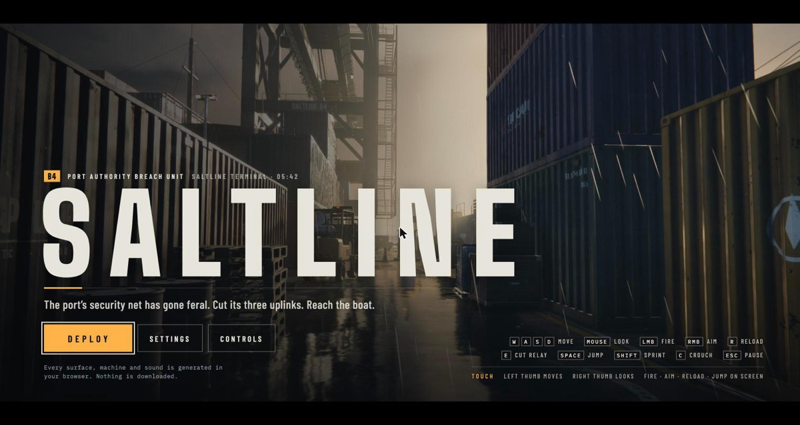
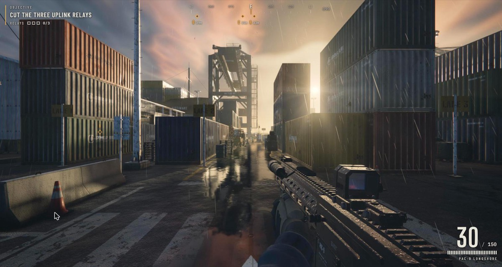
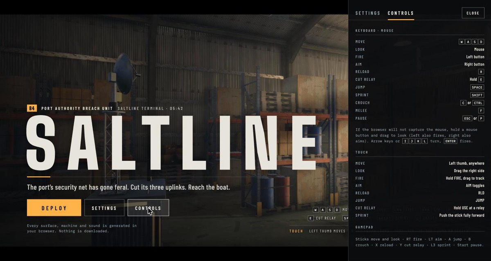

# Saltline

A browser FPS set in a rainy container port at dawn. The terminal's security net has gone feral —
cut its three uplink relays, survive what comes looking for you, and reach the boat.

**▶ Play: https://saltline-mirror.vercel.app**

No install, no download, no account. Click the page to capture the mouse and start the audio.

## Screenshots







## The game

You play a Port Authority breach unit dropped into Saltline Terminal at 05:42. Three uplink relays —
yard, shed and quay — keep the Harbormaster holding the berth. Cut all three, then get to the water.

Hunting you while you work:

- **Gulls** — drones that patrol overhead and close in once they have a fix on you
- **Hounds** — four-legged robots that run the lanes between the container stacks

You carry a PAC-9 Longshore rifle, 30 rounds in the magazine and 150 in reserve. The compass across
the top tracks each relay and its distance.

Everything you see and hear is generated in code at runtime — every surface, model, texture and
sound. Nothing is downloaded, there are no image or audio assets, and the whole game is a single
~1.4 MB HTML file running on three.js. It also runs offline once loaded.

## Controls

| | |
|---|---|
| Move | `W` `A` `S` `D` |
| Look | Mouse |
| Fire / Aim | Left button / Right button |
| Reload | `R` |
| Cut relay | Hold `E` |
| Jump / Sprint / Crouch | `Space` / `Shift` / `C` or `Ctrl` |
| Melee | `F` |
| Pause | `Esc` or `P` |

Gamepad and touch are supported too — sticks to move and look, RT to fire, LT to aim. If the browser
won't capture the mouse, hold a mouse button and drag to look; arrow keys or `I` `J` `K` `L` also turn.

## Run it locally

```sh
git clone https://github.com/sakib142/saltline-mirror.git
cd saltline-mirror
python3 -m http.server 8731
```

Then open http://localhost:8731 and click the page.

Any static file server works — the game is just `index.html` plus the fonts in `fonts/`. It needs a
browser with WebGL2 and pointer lock; a discrete GPU helps, and graphics quality is adjustable under
**Settings** if the frame rate struggles.

## Reference

Original playable artifact: https://claude.ai/artifact/BGY1SztrAYcJQHSsnHHGmp

Bundled third-party licences: [`THIRD_PARTY_NOTICES.md`](THIRD_PARTY_NOTICES.md)
