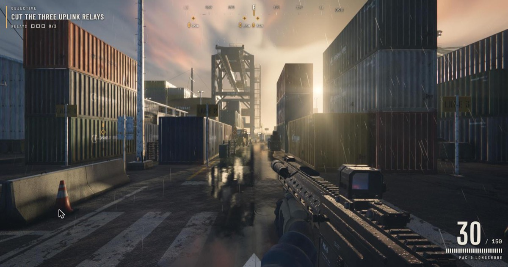

# Saltline

A browser FPS set in a rainy container port. The port's security net has gone feral — cut its three
uplink relays while drones and robot dogs hunt you, then reach the boat.

**▶ Play: https://saltline-mirror.vercel.app**

No install, no download, no account. Click to capture the mouse and start the audio.



---

## Credit where it's due

**I did not make this game.** It was generated by **Claude Fable 5.2** in a run set up by
**Felix Rieseberg**, from a single prompt with no human feedback — roughly 8 hours, ~2.7M output
tokens, ~$550 at API pricing. Every surface, machine, texture and sound is produced in code; no
assets are downloaded. Those figures are his, not mine, and I haven't verified them.

- Announcement: https://x.com/felixrieseberg/status/2119925633564463609
- Original playable artifact: https://claude.ai/artifact/BGY1SztrAYcJQHSsnHHGmp
- Upstream mirror this repo was cloned from: https://github.com/realcodebear/saltline-fable-5.2

This repo is an attributed mirror, hosted so the game is easy to play — free, no ads, no analytics,
no tracking. **The game is not open source**: see [`COPYRIGHT.md`](COPYRIGHT.md) before reusing
anything from it. It comes down on request from the original author.

## What I changed

The game logic is untouched — every change is packaging, and all of it is verifiable with a diff:

- **Restored the three.js MIT notice.** r180 is bundled minified in `index.html` with no copyright
  or license header anywhere in the 1.4 MB — I checked. MIT requires that notice in every copy. It
  now lives in [`THIRD_PARTY_NOTICES.md`](THIRD_PARTY_NOTICES.md).
- **Self-hosted the fonts.** Upstream fetched them from the Google Fonts CDN at runtime, sending
  every visitor's IP to Google. Now served from `fonts/`, so **the page makes zero third-party
  requests** and works offline.
- **Added page metadata and a favicon** — description, canonical, Open Graph / Twitter tags, so
  shared links render a preview. The metadata credits the original author.
- **Added [`vercel.json`](vercel.json)** — `nosniff`, `no-referrer`, a restrictive
  `Permissions-Policy`, and immutable caching on the fonts.

Changes are confined to the `<head>`: 19 lines added, 2 removed. Everything from `<script>` onward
is byte-identical to upstream, verified by SHA-256 of the bundle before and after each edit. Check
for yourself:

```sh
git remote add upstream https://github.com/realcodebear/saltline-fable-5.2.git
git fetch upstream
git diff upstream/main -- index.html
```

## Run it locally

```sh
python3 -m http.server 8731
```

Then open http://localhost:8731 and click the page.

Needs a browser with WebGL2 and pointer lock. Desktop is the intended experience: **W A S D** move,
mouse looks, **LMB** fires, **RMB** aims, **R** reloads, **E** cuts a relay, **Space** jumps,
**Shift** sprints, **C** crouches, **Esc** pauses. Touch controls exist but see below.

## Known issues

- **iPhone Safari:** the move stick appears and tracks your finger, but the player doesn't move
  ([upstream issue #2](https://github.com/realcodebear/saltline-fable-5.2/issues/2)). Inherited, not
  introduced here, and not yet fixed — it would mean patching the minified bundle.

## Licensing, in one line

The game belongs to its original author and carries no license; my own additions are CC0; three.js
is MIT and the fonts are OFL. Details in [`COPYRIGHT.md`](COPYRIGHT.md) and
[`THIRD_PARTY_NOTICES.md`](THIRD_PARTY_NOTICES.md).

*Not affiliated with, sponsored by, or endorsed by Anthropic.*
